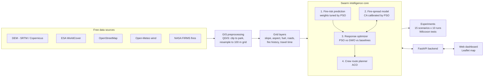
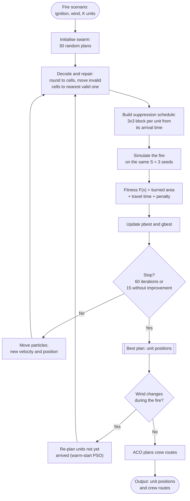
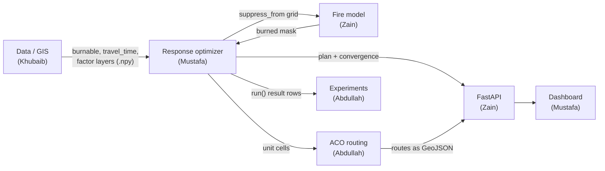
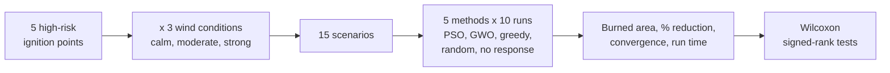
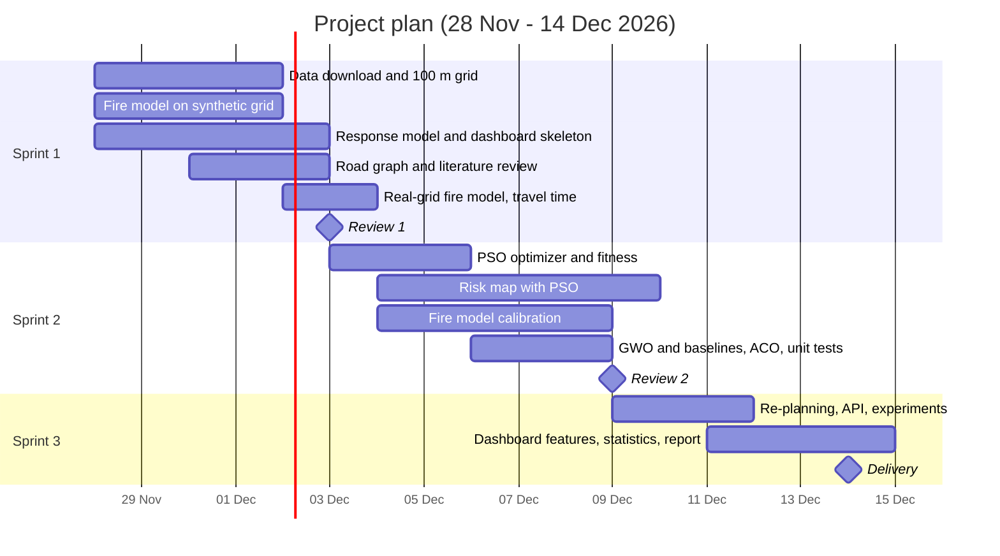
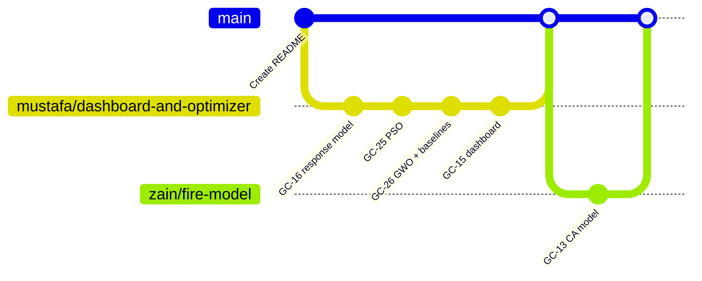

# 🔥 Margalla Wildfire Planner

**Wildfire Risk Prediction and Swarm-Optimized Response Planning for Margalla Hills National Park**

Swarm Intelligence semester project · BS(AI) 7th semester · Group C · Bahria University, Islamabad
Supervisor: **Ahsan Javed**

---

## Contents

- [What the project does](#what-the-project-does)
- [System architecture](#system-architecture)
- [The four swarm modules](#the-four-swarm-modules)
- [How a response plan is found](#how-a-response-plan-is-found)
- [Repository structure](#repository-structure)
- [Getting started](#getting-started)
- [Using the optimizer](#using-the-optimizer)
- [Interfaces between modules](#interfaces-between-modules)
- [Evaluation plan](#evaluation-plan)
- [Team and timeline](#team-and-timeline)
- [Progress](#progress)
- [How we work](#how-we-work)
- [References](#references)

---

## What the project does

Almost every year, mainly in the dry months before the monsoon, forest fires damage parts of Margalla Hills National Park. Most of the park can only be reached on foot, so crews often arrive late, and decisions about where to send them are made quickly and from experience.

This project builds a decision-support system that answers three questions:

| # | Question | How we answer it |
|---|---|---|
| 1 | **Where** is a fire most likely to start? | A fire-risk map whose factor weights are learned by **PSO** from past satellite fire detections |
| 2 | **How** will a fire spread once it starts? | A cellular-automaton fire model, calibrated to real Margalla fires with **PSO** |
| 3 | **Where should limited units go, and by which route?** | **PSO** places the units (compared with **GWO** and simple baselines); **ACO** plans the crew routes |

Everything is shown on a web map where you can start a fire, set the wind and compare the spread **with and without** the optimised response.

---

## System architecture



---

## The four swarm modules

| Module | Algorithm | What a particle / ant represents | Fitness (what is optimised) | Owner |
|---|---|---|---|---|
| **1. Fire-risk prediction** | PSO | 6 factor weights: fire history, fuel, slope, aspect, distance to roads, distance to settlements | Maximise AUC on fires from 2012–2021, tested on 2022 onwards | Khubaib |
| **2. Fire-spread model** | PSO calibration | 4 model parameters (p_h, a, c₁, c₂) | Minimise 1 − Dice overlap with real FIRMS detections | Zain |
| **3. Response optimizer** | PSO (vs GWO, 3 baselines) | Target cells of K = 3–5 units | Minimise mean burned area + λ·travel time + penalty | Mustafa |
| **4. Crew route planner** | ACO (vs Dijkstra) | One route from a fire station to a unit | Minimise travel time + slope + closeness to the fire | Abdullah |

**Key formulas**

```text
Risk index        R(i) = Σ w_k · f_k(i),          w_k ≥ 0,  Σ w_k = 1
Fire spread       P_burn = p_h (1 + p_veg)(1 + p_den) · p_w · p_s      (Alexandridis et al., 2008)
Calibration       F_cal = 1 − 2|B ∩ H| / (|B| + |H|)
Response fitness  F(x) = (1/S) Σ_s B_s(x) + λ·D(x) + P(x)
PSO               v ← w·v + c1·r1·(pbest − x) + c2·r2·(gbest − x),   x ← x + v
ACO               p_ij ∝ τ_ij^α · η_ij^β,        τ ← (1 − ρ)·τ + Σ Δτ
```

---

## How a response plan is found

Each PSO particle is a complete response plan `x = (r1, c1, …, rK, cK)`. Every time a plan is scored, the fire is simulated with that plan applied.



**PSO settings:** 30 particles · 60 iterations · c₁ = c₂ = 2.0 · inertia w falling from 0.9 to 0.4 · velocity limit 20 % of the grid · early stop after 15 iterations without improvement.
**ACO settings:** 20 ants · 100 iterations · α = 1 · β = 2 · ρ = 0.1.

---

## Repository structure

```text
group-c-project/
├── backend/
│   ├── optimizer/              # Module 3 - response optimisation
│   │   ├── response.py         #   plan decode, repair, suppression schedule
│   │   ├── fitness.py          #   F(x) with common random numbers
│   │   ├── pso.py              #   Particle Swarm Optimization (from scratch)
│   │   ├── gwo.py              #   Grey Wolf Optimizer (from scratch)
│   │   ├── baselines.py        #   no response, random, greedy downwind arc
│   │   ├── replan.py           #   re-planning after a wind change (warm-start PSO)
│   │   └── runner.py           #   run(method, scenario, ...) for experiments
│   └── tests/                  # pytest suite
├── frontend/
│   ├── index.html              # dashboard page
│   ├── css/style.css
│   ├── js/map.js               # Leaflet map
│   └── data/                   # park_boundary.geojson (from GIS step)
├── .gitignore
└── README.md
```

Folders still to come from the team: fire model (`backend/firemodel/`), risk module (`backend/risk/`), ACO routing (`backend/routing/`), FastAPI app (`backend/api/`), experiments (`backend/experiments/`) and docs (`docs/`).

> Large raw data (DEM, land cover, FIRMS downloads) is **not** stored in Git. Keep it on the shared drive; only small processed layers go in the repo.

---

## Getting started

**Requirements:** Python 3.10+, a modern browser.

```bash
git clone https://github.com/BSAI-7th-Lab/group-c-project.git
cd group-c-project

python -m venv .venv
# Windows: .venv\Scripts\activate    macOS/Linux: source .venv/bin/activate
pip install numpy scipy pytest

# run the tests
cd backend
python -m pytest -q
```

**Dashboard:** serve the `frontend` folder and open it in a browser:

```bash
cd frontend
python -m http.server 8000
# open http://localhost:8000
```

---

## Using the optimizer

Every method is called through one function, so the experiments treat PSO, GWO and the baselines the same way.

```python
from optimizer.response import GridContext
from optimizer.runner import run

ctx = GridContext(
    burnable=burnable_grid,        # bool array, True where vegetation can burn
    travel_time=travel_minutes,    # float array, minutes from nearest station (inf = unreachable)
    minutes_per_step=5.0,          # minutes per fire-model time step
)

scenario = {
    "ignition": (120, 85),         # grid row, column
    "wind_dir_deg": 135,           # direction the wind blows TOWARD (0 = north, 90 = east)
    # ...plus whatever the fire model needs
}

result = run("pso", scenario, ctx, fire_model, n_units=4, seed=0)
print(result["burned_cells"], result["cells"], result["runtime_s"])
```

`method` can be `"pso"`, `"gwo"`, `"greedy"`, `"random"` or `"none"`. The result row holds burned cells, fitness, travel minutes, penalty, number of evaluations, run time, chosen cells and the convergence history.

### Re-planning after a wind change

If the wind turns during a fire, units that are already working stay where they are. Units still on the way are re-planned with PSO, starting from the first run's swarm instead of from scratch.

```python
from optimizer.replan import run_wind_change

row = run_wind_change(scenario, ctx, fire_model,
                      t_change=12,            # step at which the wind turns
                      new_wind_dir_deg=180,   # new direction (blowing toward)
                      n_units=4, seed=0)
print(row["fixed_burned"], row["warm_burned"], row["cold_burned"])
```

The function does four things in order:

1. Plans with the forecast wind.
2. Scores that fixed plan once the wind has changed.
3. Re-plans the units that have not arrived yet, with a warm start.
4. Re-plans them again from a random swarm with the same budget, for comparison.

**Warm start.** The new swarm is made of three parts:

- **The current plan.** This means re-planning can never do worse than keeping the plan.
- **About two thirds:** the best positions from the first run, slightly jittered.
- **The rest:** random plans.

**Arrival times.** A unit sent to a new target is treated as dispatched again from the station at `t_change`. This is a cautious assumption until ACO redirect times are available (GC-28).

For the dashboard, `situation_at(plan, t)` and `replan(...)` handle a single re-plan step.

---

## Interfaces between modules

These contracts let everyone work in parallel. Change them only after agreeing in the group.



| Contract | Shape | Meaning |
|---|---|---|
| `fire_model(scenario, suppress_from, seed)` | returns `bool` array, grid shape | Cells burned at the end of the simulation |
| `suppress_from` | `int` array, grid shape | First time step a cell is suppressed; `NO_SUPPRESSION` where no unit works |
| `travel_time` | `float` array, grid shape | Minutes from the nearest fire station; `inf` = unreachable |
| Wind direction | degrees | Direction the wind blows **toward**. Open-Meteo gives where it comes **from**, so add 180° |
| `scenario["wind_change"]` | `{"step": int, "wind_dir_deg": float}`, optional | Wind turns at `step`. The fire model reads the wind each step through `wind_direction_at(scenario, t)` |

---

## Evaluation plan



| Module | Compared with | Metric |
|---|---|---|
| Fire-risk map | Equal weights, fire history only | AUC on 2022+ fires |
| Fire model | Published parameters | Dice overlap on a validation fire |
| Response optimizer | GWO, greedy, random, no response | Burned area (ha), % reduction, Wilcoxon test |
| Re-planning | Fixed plan | Burned area in wind-change scenarios |
| Crew routes | Dijkstra | Gap to optimal cost, distance from the fire |

---

## Team and timeline

| Member | Role |
|---|---|
| **Mustafa Waheed** | Response optimizer (PSO, GWO, baselines, re-planning) and web dashboard |
| **Muhammad Zain ul Abidin** | FastAPI backend, fire-spread model and calibration, integration |
| **Khubaib Nasir** | Data collection, GIS preprocessing, travel-time map, fire-risk module |
| **Abdullah Khan** | UI/UX design, ACO route planning, experiments and statistics |
| **Qasim Mustafa** | Documentation, report, testing and presentation |

Tasks are tracked on the **Group C Jira board** (project key `GC`).



---

## Progress

| Jira | Task | Owner | Status |
|---|---|---|---|
| GC-15 | Dashboard skeleton (Leaflet map, controls) | Mustafa | ✅ Done |
| GC-16 | Response model: decode, repair, suppression | Mustafa | ✅ Done |
| GC-25 | Fitness function and PSO optimizer | Mustafa | ✅ Done |
| GC-26 | GWO, baselines and `run()` interface | Mustafa | ✅ Done |
| GC-35 | Adaptive re-planning with warm-start PSO | Mustafa | ✅ Done |
| GC-9 – GC-11 | Data, 100 m grid, travel time, risk layers | Khubaib | ⏳ Planned |
| GC-12 – GC-14 | Repo/API skeleton, fire model | Zain | ⏳ Planned |
| GC-17, GC-18 | Style guide, road graph | Abdullah | ⏳ Planned |
| GC-19, GC-20 | Proposal, literature review | Qasim | ⏳ Planned |

The optimizer is currently tested with a small stand-in fire model (`backend/tests/conftest.py`). It switches to the real model once GC-13/GC-14 are merged.

---

## How we work



1. **One branch per person or feature**, e.g. `khubaib/data-grid`, `zain/fire-model`.
2. **Start every commit message with the Jira key**, e.g. `GC-13: add CA fire model`, so commits show up on the Jira task.
3. **Open a pull request into `main`**, and have one teammate review it before merging.
4. **Run the tests before pushing:** `cd backend && python -m pytest -q`.
5. **No large data files in Git.** Raw downloads go on the shared drive.

---

## References

1. Alexandridis, A. et al. (2008) A cellular automata model for forest fire spread prediction. *Applied Mathematics and Computation*, 204(1), 191–201.
2. Kennedy, J. and Eberhart, R. (1995) Particle Swarm Optimization. *Proc. IEEE ICNN*, 1942–1948.
3. Shi, Y. and Eberhart, R. (1998) A Modified Particle Swarm Optimizer. *Proc. IEEE ICEC*, 69–73.
4. Mirjalili, S., Mirjalili, S.M. and Lewis, A. (2014) Grey Wolf Optimizer. *Advances in Engineering Software*, 69, 46–61.
5. Dorigo, M., Maniezzo, V. and Colorni, A. (1996) Ant System. *IEEE Trans. SMC Part B*, 26(1), 29–41.
6. Schroeder, W. et al. (2014) The New VIIRS 375 m active fire detection data product. *Remote Sensing of Environment*, 143, 85–96.

Data: NASA FIRMS · ESA WorldCover · SRTM / Copernicus DEM · OpenStreetMap contributors · Open-Meteo.
